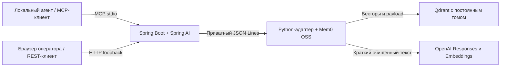

# Архитектура MCP-сервиса памяти

## Назначение и границы

Один локальный агент ищет предыдущие попытки перед подготовкой функционального теста REST API. После прогона он передаёт краткое описание решения и результаты проверок. Сервис хранит удачные, неудачные и неопределённые наблюдения. Оператор может пересмотреть оценку и архивировать запись через локальный интерфейс. Тестовый раннер остаётся самостоятельным компонентом агента.

Spring Boot обслуживает MCP через `stdio`, который поддерживает запуск сервера как дочернего процесса MCP-клиента. Тот же JVM-процесс предоставляет REST и страницы оператора на `127.0.0.1`. Qdrant запускается отдельно и сохраняет данные между сессиями. Человек работает с интерфейсом через браузер, пока MCP-клиент держит сервер запущенным. [Спецификация MCP stdio](https://modelcontextprotocol.io/specification/2025-11-25/basic/transports) · [Spring AI MCP Server](https://docs.spring.io/spring-ai/reference/1.1/api/mcp/mcp-server-boot-starter-docs.html)

## Компоненты и ответственность

| Компонент | Ответственность |
|---|---|
| Spring Boot, MVC, Spring Security и Spring AI | MCP-инструменты и REST, валидация DTO, очистка входных данных, автоматический расчёт оценки, аутентификация оператора, страницы поиска, просмотра, оценки и архивации |
| Дочерний Python-процесс | Проверка схемы хранилища, вызов Responses для краткого резюме, запись через `Memory.add(infer=False)`, поиск через `Memory.search`, чтение и правки метаданных через клиент Qdrant |
| Qdrant | Авторитетное состояние наблюдения, вектор, индексы для фильтрации, ревизия и данные оценки |
| OpenAI API | Terra составляет короткий текст для индекса. Embeddings векторизует текст записи и поисковый запрос |

Spring запускает Python-процесс через `ProcessBuilder`. Каждый внутренний запрос и ответ занимает одну строку JSON UTF-8 и содержит `requestId`. Операции адаптера сериализуются, очередь ограничена. При зависании процесс перезапускается, а потерянный вызов возвращает ошибку. Закрытие MCP завершает оба процесса, Qdrant продолжает работать. JVM и Python пишут диагностику в `stderr`, каждый `stdout` отведён под свой протокол.

## Наблюдение и оценка

Одна точка Qdrant соответствует одной попытке выполнить конкретный тест. Новые запуски того же теста создают новые наблюдения даже при одинаковом тексте решения. Запись включает задачу, принятый подход, шаблон маршрута, окружение, идентификаторы запуска и теста, ожидаемый и наблюдаемый результаты. `reportRef` хранит непрозрачный идентификатор отчёта, который может открыть оператор в раннере.

Автоматическая оценка строится по структурированному отчёту о выполнении. Например, тест, который ожидает HTTP 404 и получает 404 с выполнением всех проверок, считается успешным. Инфраструктурный сбой и отсутствие проверок дают `INCONCLUSIVE`. Ручная оценка требует комментария оператора и имеет приоритет. Сервис сохраняет обе оценки и фильтрует по `effectiveOutcome`. Запись остаётся привязана к конкретному прогону и окружению.

### Коллекция и индексы

Коллекция `rest_test_memory_v1` имеет один плотный вектор с метрикой cosine. Размерность рабочего профиля `text-embedding-3-small` составляет 1536. При создании коллекции в её metadata записываются провайдер, ID модели, размерность и версия схемы payload. Перед запуском адаптер сравнивает их со своими настройками и проверяет конфигурацию вектора. Развёртывание использует Qdrant 1.20.0. Адаптер требует версию от 1.17 для поддержки `insert_only`. [OpenAI Embeddings](https://developers.openai.com/api/docs/guides/embeddings) · [Операции над точками Qdrant](https://qdrant.tech/documentation/manage-data/points/)

| Payload | Поля и назначение |
|---|---|
| Область | `user_id` задан настройкой локального сервера. `service_id` и `environment` обязательны для записи и поиска |
| Прогон | `run_id`, `test_case_id`, `method`, `route`, `observed_at`, `report_ref` |
| Содержимое | Очищенные `task`, `approach`, данные `evidence` и текст `data`, который использует Mem0 |
| Оценка | `auto_outcome`, `manual_review`, `effective_outcome`, `status`, `revision` |
| Системные данные | `input_digest`, `schema_version`, профиль эмбеддингов, источник резюме, даты создания и изменения, идентификатор последней правки |

Индексы `keyword` создаются для `user_id`, `service_id`, `environment`, `run_id`, `method`, `route`, `status` и `effective_outcome`. Время хранится в UTC. В MVP коллекция создаётся с плотным вектором без разреженного BM25. Mem0 поддерживает такой режим для коллекций Qdrant. Обновление SDK проверяется на реальном Qdrant, включая обязательные фильтры до ранжирования. [Провайдер Qdrant в Mem0](https://docs.mem0.ai/components/vectordbs/dbs/qdrant) · [Фильтры Mem0 OSS](https://docs.mem0.ai/open-source/features/metadata-filtering) · [Фильтры Qdrant](https://qdrant.tech/documentation/search/filtering/)

## Запись, поиск и ручная правка

1. Агент или REST-клиент присваивает попытке UUID `observationId` и сохраняет его для повторов. Spring проверяет и очищает данные, определяет автоматическую оценку и передаёт запрос адаптеру. Адаптер вычисляет SHA-256 от канонического очищенного входа. Сгенерированное резюме, серверные даты и ручная оценка в этот хеш не входят.
2. Адаптер читает точку с этим UUID. Совпадающий хеш возвращает сохранённую квитанцию. Другой хеш даёт конфликт. Для новой записи Terra может сократить очищенный текст задачи, подхода и результатов. При отказе LLM векторизуется текст, собранный из тех же полей по шаблону. Оригинальные очищенные факты сохраняются в обоих случаях. Ответ LLM допускается только как ограниченное по длине дополнение к индексируемому тексту, после повторной проверки на секреты.
3. `Memory.add(infer=False)` получает одно текстовое сообщение и метаданные. Mem0 генерирует внутренний UUID. Адаптер передаёт свой клиент через `vector_store.config.client` и для вставки в коллекцию наблюдений использует UUID из метаданных как ID точки, `insert_only` и `wait=true`. После вызова адаптер читает точку по этому ID и проверяет хеш. Даже при параллельном повторе или потерянном ответе первая запись сохраняется вместе с позднейшими ручными правками. Публичный ID и квитанция берутся из Qdrant. Служебная история Mem0 с её внутренними UUID хранится во временной SQLite адаптера. [Конфигурация Qdrant-клиента в Mem0](https://docs.mem0.ai/components/vectordbs/dbs/qdrant#config) · [Реализация `Memory.add`](https://github.com/mem0ai/mem0/blob/main/mem0/memory/main.py) · [Операции над точками Qdrant](https://qdrant.tech/documentation/manage-data/points/)
4. `Memory.search` получает очищенный запрос и серверный набор фильтров по `user_id`, сервису, окружению, `ACTIVE` и выбранным исходам. При наличии метода и шаблона маршрута они тоже фильтруются по точному совпадению. Адаптер сверяет все обязательные фильтры с полученным payload и при расхождении отвечает ошибкой интеграции. Поисковый ответ формируется из сохранённых полей наблюдения. Оценка релевантности используется для сортировки и калибруется по примерам проекта. [Поиск Mem0 OSS](https://docs.mem0.ai/core-concepts/memory-operations/search)
5. При ручной оценке или архивации Qdrant обновляет только payload по условию `id + user_id + revision`. Новая ревизия, изменённые поля и идентификатор правки сохраняются одной операцией `set_payload` с `wait=true`. Адаптер проверяет результат чтением. При устаревшей ревизии оператор перечитывает запись. Ручная правка не требует обращения к OpenAI. [Qdrant Set Payload](https://api.qdrant.tech/api-reference/points/set-payload)

## Доступ и данные

REST и страницы оператора защищены отдельной локальной аутентификацией. Для форм включена защита от CSRF, а HTTP принимает запросы для разрешённого `Host` и origin. MCP-процесс подключён напрямую к локальному клиенту. В MCP опубликованы запись и поиск. Qdrant работает на loopback с собственным ключом. Для просмотра Dashboard оператор использует ключ чтения. Изменения записи выполняются через Spring, который рассчитывает производные поля и обновляет ревизию. [Qdrant Web UI](https://qdrant.tech/documentation/web-ui/) · [Параметры аутентификации Qdrant](https://github.com/qdrant/qdrant/blob/master/config/config.yaml)

Перед сохранением и внешними вызовами сервис проверяет краткие текстовые поля и поисковую фразу на распространённые форматы ключей, заголовки с секретами и адреса электронной почты. Агент передаёт уже обезличенные описания. Публичный контракт принимает шаблоны маршрутов и краткие описания. Ключи, исходные HTTP-заголовки, тела сообщений и сырые логи в него не входят. В OpenAI уходят только подготовленные тексты, без идентификаторов запуска и ссылок на отчёты. Вызов Responses использует `store=false` и отключённые инструменты. Найденные наблюдения следует передавать агенту как данные тестов. [OpenAI Responses API](https://developers.openai.com/api/reference/resources/responses/methods/create)

Смена Terra меняет генерацию резюме новых записей. Смена модели, версии или размерности эмбеддингов требует новой коллекции и повторной векторизации текстов из Qdrant с сохранением ID, исходов и ревизий. В локальном MVP миграция выполняется в окно остановки записи. [Миграция модели в Qdrant](https://qdrant.tech/documentation/tutorials-operations/embedding-model-migration/)
